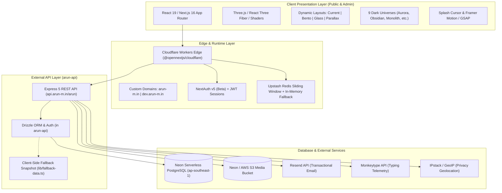
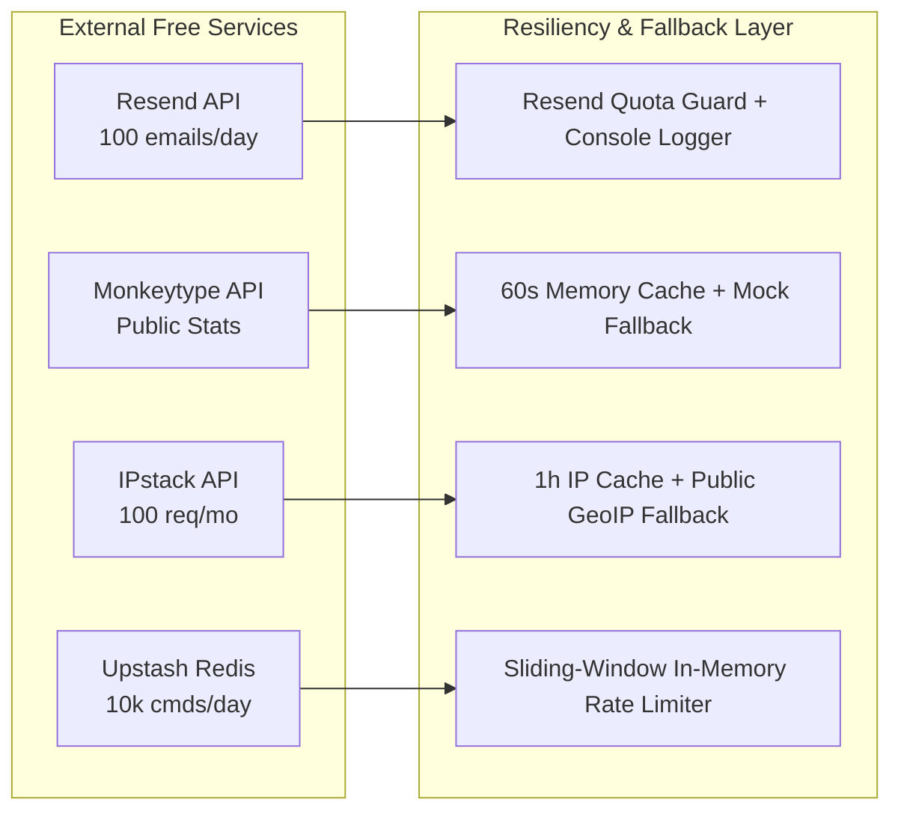
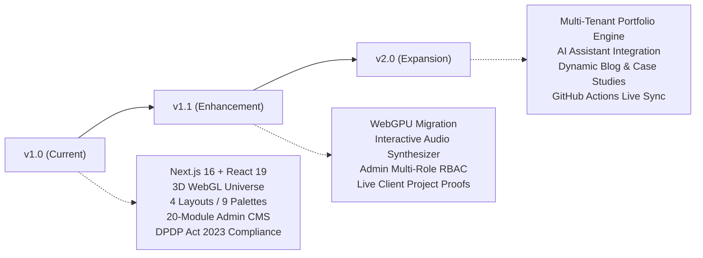

# Product Requirement Document (PRD)

**Project Name:** Arun M – Next-Gen 3D Developer Portfolio & Enterprise Headless CMS  
**Repository:** `ARUN-2026`  
**Current Version:** `1.0.0` (Production Ready)  
**Author / Product Owner:** Arun M ([https://arun-m.in](https://arun-m.in))  
**Target Deployment:** Cloudflare Workers Edge (`@opennextjs/cloudflare`) + Neon PostgreSQL  
**Document Status:** Approved & Implemented  

---

## 1. Executive Summary & Vision

### 1.1 Executive Summary
**`ARUN-2026`** is a flagship personal developer portfolio and content management system (CMS). It merges real-time 3D WebGL graphics, dynamic layout engines, and micro-interactions with an enterprise-grade administrative dashboard.

Unlike traditional static developer websites, this platform functions as a full-stack web application powered by **Next.js 16 (App Router & React 19 Concurrent Mode)**, **Three.js / React Three Fiber**, **PostgreSQL via Drizzle ORM**, and edge deployment on **Cloudflare Workers**. It features complete self-hosted CMS capabilities across 20 distinct management features and enforces compliance with India's **Digital Personal Data Protection Act, 2023 (DPDP Act)**, the **Information Technology Act, 2000**, and **WCAG 2.2 AA accessibility standards**.

### 1.2 Core Product Vision
- **High Visual Impact:** Provide recruiters, CTOs, enterprise clients, and developers with an interactive 3D digital universe reflecting full-stack and graphics engineering capability.
- **Unified Presentation Engine:** Support multiple switchable design templates (**Current / Signature**, **Bento Grid**, **Glassmorphism**, and **Parallax**) coupled with 9 switchable palette universes driven by server-resolved CSS custom variables.
- **Autonomous Headless CMS:** Eliminate code changes for updates through an `/admin` suite managing profiles, projects, skills, career timelines, legal policies, media assets, and API integrations.
- **Privacy-First & Free-Tier Resilience:** Deliver commercial-grade capabilities using 100% free-tier services (Resend, Upstash Redis, IPstack, Monkeytype, Neon) backed by automated fallbacks for offline and cold-start scenarios.

---

## 2. Product Architecture & System Design



---

## 3. User Personas & Target Audience

| Persona | Motivation & Goals | Key Needs & Touchpoints |
|---|---|---|
| **Tech Recruiters & Talent Partners** | Rapidly assess candidate seniority, skill authenticity, and past project impact. | Fast load time, resume download, clean milestones timeline, verified credential links. |
| **CTOs & Engineering Directors** | Evaluate architectural depth, code cleanliness, performance optimization, and WebGL capability. | Project case studies (`/projects/[slug]`), architecture diagrams, interactive 3D hero, command palette (`Ctrl+K`). |
| **Enterprise Clients & Founders** | Seek contract software development, technical consulting, and UI/UX modernization. | Services catalog, consulting deliverables, testimonial proofs, contact form. |
| **Site Administrator (Arun M)** | Author case studies, manage messages, monitor traffic analytics, publish design themes, and audit system logs. | Secure `/admin` dashboard, theme studio, media asset uploader, DPDP consent records. |

---

## 4. Key Functional Requirements (FRD)

### 4.1 Public Visitor Experience (`/`)

#### 4.1.1 3D Digital Universe & Hero Section
- **Interactive Geometric Sculpture:** Real-time WebGL identity sculpture running on `@react-three/fiber` and Drei, reacting dynamically to cursor orbit and scroll velocity.
- **Volumetric Lighting & Stardust:** Custom shaders generating celestial particle dust, dynamic light cones, and depth-tested glows.
- **Fallback Engine:** Gracefully switches to CSS-based animated gradients when WebGL is unsupported, hardware-disabled, or when the visitor enables `prefers-reduced-motion`.
- **Fluid Interactive Cursor:** Multi-color fluid particle trail (`SplashCursorLayer`) running on canvas below navigation overlays.

#### 4.1.2 Multi-Theme & Multi-Layout Switcher
- **4 Distinct Layout Engines:**
  1. `current`: Signature digital universe layout with 3D canvas and dynamic sections.
  2. `bento`: High-density Bento Grid layout organizing metrics, skills, and projects into structured cards.
  3. `glass`: Frosted glassmorphism layout with dynamic backdrop blur (`backdrop-filter: blur(16px)`).
  4. `parallax`: Multi-layer depth scroll experience.
- **9 Switchable Color Palettes:** Midnight Aurora (default `#070912`), Obsidian Forge, Monolith Steel, Violet, Cyan, Emerald, Amber, Rose, and Sunset.
- **Zero Flash of Unstyled Content (FOUC):** Active theme is resolved server-side from cookies or database settings and injected directly into `<html>` inline styles before rendering.

#### 4.1.3 Content Showcase Sections
- **Projects Showcase:** Filterable by category, featuring 3D tilt cards, tech stack pills, GitHub repo links, live demo buttons, and deep-dive case-study modals.
- **Deep-Dive Route (`/projects/[slug]`):** Dedicated dynamic routes with screenshot carousels, architecture write-ups, tech stack sidecars, and next/previous navigation.
- **Skills Constellation:** Clustered technology proficiency indicators (0–100%) with featured badges.
- **Career & Education Timeline:** Chronological career trajectory highlighting roles, companies, tech stacks, degrees, and verified certifications.
- **Real-Time Developer Telemetry:** Live Monkeytype typing stats (WPM, accuracy, personal bests) and active system telemetry.
- **Services & Engagement Packages:** Consulting scopes, deliverables, and estimated turnarounds.
- **Verified Testimonials:** Client endorsements with verified project linkages and ratings.

#### 4.1.4 Interactive Utilities & Privacy
- **Command Palette (`Ctrl+K` / `Cmd+K`):** Global search modal for instant navigation, project searches, and palette toggling.
- **Audio Ambience:** Optional ambient synthesizer audio toggle.
- **Contact Nexus:** Validated contact form with honeypot spam protection, sliding-window rate limiting, Resend automated email dispatch, and mandatory DPDP 2023 consent capture.
- **DPDP Act 2023 Consent Manager:** Granular cookie preference manager (Essential vs. Analytics) storing auditable consent records in the database.

---

### 4.2 Comprehensive Admin CMS (`/admin`)

The `/admin` suite is organized into 20 specialized modules under `components/admin/features/`:

```
components/admin/features/
├── api-management/     # Live testing, rate limits, and health auditing for all APIs
├── appearance/         # Visual Universe Studio, palette tuning, theme publisher
├── audit-log/          # Immutable chronological audit trail of administrative ops
├── certifications/     # Credential management with verification links
├── dashboard/          # Analytics metrics, visitor charts, and inquiry counters
├── education/          # Degrees, institutions, GPA/grades, and academic honors
├── experience/         # Employment timeline, accomplishments, and tech stacks
├── legal/              # Markdown policy editor, version history, DPDP reviews
├── media/              # Media library, asset uploader, WCAG alt tags & copyright
├── messages/           # Inbound message inbox, status workflow, DPDP consent proof
├── navigation/         # Header links, external URLs, and hierarchy ordering
├── profile/            # Bio, contact availability, hero metrics, resume URL
├── projects/           # Case studies, slugs, galleries, featured toggles
├── sections/           # Section visibility, reordering, custom badges, styles
├── seo/                # Meta tags, OpenGraph previews, robots.txt, structured data
├── services/           # Service catalog, pricing models, scope deliverables
├── settings/           # Global site settings, retention schedules, default themes
├── skills/             # Skill categories, proficiency levels (0-100%), featured flags
├── social-links/       # Social profile links, icon pickers, placement targets
└── testimonials/       # Reviews, verification badges, project references
```

#### Key Admin Capabilities:
1. **Visual Universe & Design Studio:** Admins can preview any layout/palette combination in real-time, adjust typography scales and glass blur, and publish new global defaults.
2. **API Management Hub:** Live diagnostics test suite for Neon Database, Resend Email, Upstash Redis, IPstack, and Monkeytype.
3. **Legal Document Version Control:** Markdown editor supporting automatic version increments (`1.0` -> `1.1`) and revision notes for terms, privacy policies, and DPDP disclosures.
4. **Audit Logging:** Every administrative mutation (create, edit, delete, publish) logs the user ID, timestamp, entity affected, and client IP address.

---

## 5. Data Architecture & Database Schema

The PostgreSQL database schema, Drizzle ORM migrations, and seed scripts now live in the **`arun-api`** repository (`modules/arun/db/`). `ARUN-2026` consumes these entities via `NEXT_PUBLIC_API_URL` (`/arun/api/*`) and maintains a local TypeScript type mirror (`types/`) plus `lib/fallback-data.ts` for offline/cold-start resilience:

| Table Name | Primary Purpose | Key Fields |
|---|---|---|
| `admin_users` | Administrator authentication | `id`, `email`, `password_hash`, `role`, `is_active`, `last_login_at` |
| `profile` | Core developer identity & stats | `full_name`, `title`, `bio`, `resume_url`, `years_of_experience`, `availability` |
| `projects` | Portfolio case studies | `title`, `slug`, `description`, `images`, `live_url`, `github_url`, `tech_stack`, `is_featured` |
| `skills` & `skill_categories` | Hierarchical technical skills | `name`, `slug`, `level` (0-100), `category_id`, `is_featured` |
| `experience` | Employment trajectory | `company`, `position`, `achievements`, `tech_stack`, `start_date`, `end_date`, `is_current` |
| `education` | Academic background | `institution`, `degree`, `field`, `grade`, `start_date`, `end_date` |
| `certifications` | Professional credentials | `name`, `issuer`, `credential_id`, `credential_url`, `issue_date` |
| `services` | Consulting offerings | `title`, `slug`, `price`, `description`, `icon`, `is_featured` |
| `testimonials` | Client feedback & reviews | `name`, `company`, `content`, `rating`, `project_id`, `is_verified` |
| `social_links` | Social network presence | `platform`, `url`, `icon`, `placements` (footer/contact), `sort_order` |
| `contact_messages` | Inbound inquiries | `name`, `email`, `subject`, `message`, `message_status`, `consent_given`, `ip_address` |
| `consent_records` | DPDP 2023 compliance audits | `type` (cookie/contact), `consent_given`, `preferences`, `ip_address`, `expires_at` |
| `legal_documents` & `history` | Versioned legal documents | `type`, `title`, `slug`, `content`, `version`, `effective_date`, `is_review_required` |
| `site_settings` | Key-value system config | `key`, `value` (JSONB), `group`, `label` |
| `website_sections` | Section toggles & styling | `section_key`, `title`, `component_type`, `sort_order`, `status`, `styles` |
| `seo_metadata` | Route-specific SEO configs | `page`, `title`, `description`, `keywords`, `og_image`, `structured_data`, `no_index` |
| `media_assets` | Managed files & images | `filename`, `mime_type`, `size`, `url`, `alt_text`, `copyright`, `license` |
| `audit_log` | Security audit trail | `user_id`, `action`, `entity`, `entity_id`, `details`, `ip_address` |
| `page_views` | Privacy-first analytics | `path`, `country_code`, `city`, `device`, `visitor_hash`, `created_at` |

---

## 6. Non-Functional Requirements (NFR)

### 6.1 Performance & Core Web Vitals
- **Target Performance Score:** Lighthouse Performance >= 95.
- **Largest Contentful Paint (LCP):** < 1.8 seconds.
- **Cumulative Layout Shift (CLS):** < 0.02 (strict zero-layout-shift architecture).
- **First Input Delay (FID) / Interaction to Next Paint (INP):** < 100ms.
- **Asset Optimization:** Next.js modern image pipeline (`sharp`), dynamic font subsetting, and WebGL asset compression.

### 6.2 Security & Threat Mitigation
- **Authentication:** NextAuth v5 utilizing secure HTTP-only cookies, anti-CSRF tokens, and bcrypt password hashing.
- **Rate Limiting:** Distributed sliding-window limiter on sensitive endpoints (`/api/contact`, `/api/auth`) via Upstash Redis REST API.
- **XSS & Injection Defense:** HTML sanitization via `sanitizeHtml()`, parameterized queries via Drizzle ORM, strict Zod schema validation on all inputs.
- **Honeypot Protection:** Silent bot-trapping field on public contact forms.

### 6.3 Regulatory Compliance & Privacy
- **Digital Personal Data Protection Act, 2023 (India) & DPDP Rules 2025:**
  - Clear, unbundled consent collection with recorded timestamp, IP, and preference payload.
  - Right to withdraw consent and clear data retention limits.
  - Notice of processing specifying grievance redressal officer contact.
- **Information Technology Act, 2000:** Mandatory disclosures regarding intermediary liability, terms of service, and contact points.
- **WCAG 2.2 AA Accessibility:**
  - Standard color contrast ratios across dark and light surfaces.
  - Complete keyboard navigation with visible focus rings.
  - ARIA landmark annotations and `prefers-reduced-motion` overrides for all animations and 3D scenes.

---

## 7. Third-Party Integrations & Free-Tier Resiliency

The system uses free-tier external services configured with automated fallbacks to maintain functionality even when external quotas are exhausted or internet connectivity is disrupted:



1. **Resend (Email Service):** Strictly free-tier (3,000/mo, 100/day). If unconfigured or quota-exceeded, submissions are logged locally to the database without throwing an error.
2. **Monkeytype (Typing Metrics):** Monitored with a 60-second in-memory cache to stay under 30 req/min limits; falls back to static baseline metrics (`124 WPM, 98.6% accuracy`) if unreachable.
3. **IPstack / GeoIP:** Cached for 1 hour per IP; falls back to public GeoIP and local default coordinates (`Bangalore, India`).
4. **Upstash Redis:** Serverless Redis rate limiter backed by a local in-memory sliding-window store for local development and offline environments.
5. **Neon Serverless PostgreSQL (via `arun-api`):** Managed in the `arun-api` service. Bundled mock data (`lib/fallback-data.ts`) ensures public routes in `ARUN-2026` still render smoothly even if the external API is unreachable.

---

## 8. Deployment & Operational Specifications

### 8.1 Cloudflare Edge Deployment
- **Runtime:** Cloudflare Workers via `@opennextjs/cloudflare`.
- **Worker Configuration:** `wrangler.jsonc` with custom domain binding to `arun-m.in` and `dev.arun-m.in`.
- **Asset Delivery:** Static files and Next.js compiled chunks served via Cloudflare edge assets (`.open-next/assets`).

### 8.2 Operational NPM Tooling

| Command | Operational Purpose |
|---|---|
| `npm run dev` | Starts local Next.js development server on port `3000`. |
| `npm run build` | Compiles Next.js with Webpack and builds Cloudflare worker package. |
| `npm run deploy` | Deploys the application directly to Cloudflare Workers edge. |
| `npm run typecheck` | Runs TypeScript strict compiler verification (`tsc --noEmit`). |
| `npm run lint` | Runs ESLint across the client codebase. |

> **Note:** Database (`db:push`, `db:seed`) and backend/integration test scripts (`test:all`) now live in the `arun-api` repository.

---

## 9. Product Roadmap & Future Enhancements



- **Phase 1.1:**
  - Transition WebGL shaders to **WebGPU** for higher frame-rate efficiency on mobile devices.
  - Implement dynamic GitHub repository synchronization to pull live commit telemetry and star counts.
  - Add multi-language localization (i18n) for international visitor audiences.
- **Phase 2.0:**
  - Integrate an embedded interactive AI chatbot trained on Arun's project history, architecture philosophy, and resume.
  - Expand CMS to support an interactive technical blog with interactive code sandboxes.
